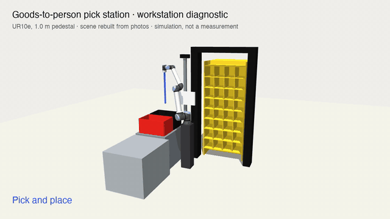

# can-a-robot-do-it

**Snap a workstation. Get a robot cell: which arm, where to put it, how fast, and what to measure first.**



Take photos (or a short video) of a workstation and one sentence about the task. Get back a robot simulation of that workstation and an engineering answer: which arm, where to put it, what it reaches, how fast, and which dimensions to measure on site before deciding.

Vendor tools check a cell you have already modelled by hand, for their own arms. This starts from phone photos, works with any arm in MuJoCo Menagerie, says how sure it is, and is open source.

Built by [ARI — Applied Robotics Institute](https://arirobotics.ch). Version 0.1: it works end to end on one real case (a goods-to-person pick station) and is honest about what it does not test.

## Use it from Claude Code

No API key needed: Claude Code does the reading of your photos.

```
/plugin marketplace add ari-robotics/can-a-robot-do-it
/plugin install can-a-robot-do-it@ari-robotics
```

Then share your photos and ask: *"Can a robot do this station?"* Or clone the repo and open it in Claude Code: the skill in `.claude/skills/workstation-sim/` is picked up directly.


## How it works

```
photos / video ──► perceive ──► scene.json ──► diagnose ──► report.md, diagnostic.png, cycle.mp4
   + task          (Claude)     (parametric)   (MuJoCo)
                                     │
                                     └──► grasp (experimental): physics episodes with scanned objects
```

1. **Perceive.** Claude reads the images and writes `scene.json`: the workstation as a handful of components (boxes, shelf units, totes, pick and place points), with every estimated dimension declared as a parameter *with its uncertainty* and the scale references it relied on. The scene is compiled; if it fails, or if renders of it do not match the photos, the error goes back to the model to fix.
2. **Diagnose.** Each candidate robot is tried at a grid of base positions and pedestal heights. For the best one, a collision-free path is planned for every pick target (IK, straight-line insertion, RRT-Connect) and timed at joint speed limits.
3. **Quantify the doubt.** A photo gives geometry to within 10–20 %. The scene is re-simulated on dozens of plausible variants, so the report says how often the layout still works and which dimensions move the result most — the ones to measure first.
4. **Grasp (experimental).** Swap the suction wand for a Robotiq 2F-85, drop Google Scanned Objects into the pick cells with random pose, and run a scripted expert with real contact physics. Episodes are recorded (image, joints, action) as raw material for imitation learning.

## Quick start

```bash
pip install -e ".[perceive]"
ari-sim setup                       # robot models + 110 scanned objects, ~350 MB in ~/.cache/ari_sim
ari-sim diagnose examples/goods_to_person_station/scene.json --out examples/goods_to_person_station/out
```

From your own photos (needs `ANTHROPIC_API_KEY`):

```bash
ari-sim run --photos station1.jpg station2.jpg --task "Pick parts from the bin and load them into the machine" --out out
ari-sim run --video walkaround.mp4 --task "…" --out out
```

Without an API key, use it from Claude Code (above): the skill walks Claude through the same steps, with Claude Code doing the reading.

Other commands: `ari-sim perceive` (photos → scene only), `ari-sim check scene.json` (validate and render), `ari-sim grasp scene.json --episodes 100`.

Headless Linux needs EGL (`MUJOCO_GL=egl`, set by default). Video output needs `ffmpeg`.

## The scene format

A scene is JSON. Numbers can be expressions over named params, which is what makes the uncertainty run possible:

```json
"params":     { "tote_rim": {"value": 1.12, "sigma": 0.07, "note": "tote rim height"} },
"components": [ {"type": "tote", "name": "tote", "center": ["-(open_w/2 + 0.16 + tote_dx)", "tote_y"], "rim": "tote_rim", "place": true} ]
```

Component library: `box`, `cylinder`, `shelf_unit` (every cell becomes a pick target), `tote` (drop target), `pick_point`, `place_point`. See `ari_sim/spec.py` and the [example](examples/goods_to_person_station/scene.json). Expressions are parsed, never `eval`-ed.

## Results on the example

Pick station rebuilt from three phone photos; 32 pod cells, one tote.

| | |
|---|---|
| Robot | UR10e is the only candidate that covers the station (UR5e and CRX-5iA rarely reach the tote) |
| Base | 0.6 m left of the pod axis, 0.6 m back, 1.0 m pedestal |
| Full collision-free cycle | 25 of 32 cells, about 6.2 s per cycle at joint speed limits |
| Across 40 plausible variants | fixed pedestal: the drop becomes unreachable in 13; with a vertical axis: in 0 |
| Measure first | tote rim height |

Physics grasping baseline, 300 episodes (3 seeds × 100) over 31 scanned objects, scripted side grasp with a parallel gripper: 122 objects too wide for the gripper in that orientation, 100 with no collision-free path or no reachable pre-grasp (mostly the far pod columns), 78 attempted, **17 delivered to the tote** (4 to 7 per 100 episodes, 22 % of attempts). That is the gap a learned policy has to close, and a hint that this station wants suction rather than fingers.

Numbers move a little between runs (random IK seeds and sampling).

## What it does not do

- **It does not judge grasp reliability.** The diagnostic checks reach, clearance and timing. Whether a robot can grip a soft item behind an elastic band is a different question; the grasp module only starts on it.
- **Cycle times are ceilings.** Joint speed limits, no payload, no safety-rated speed reduction.
- **Geometry is primitives.** Boxes and cylinders are enough for reach and clearance, not for fine contact with the workstation itself.
- **Perception was validated by hand on one station.** The example `scene.json` was authored from the photos with the same rules the perception prompt gives the model; the automated `perceive` loop has not yet been run against a set of stations with known dimensions.
- **Grasping covers horizontal picks only** (shelf cells), with one fixed strategy and no learned policy yet.
- **Three arms** (UR5e, UR10e, Fanuc CRX-5iA). Adding one from MuJoCo Menagerie is a line in `ari_sim/robots.py`.

## Roadmap

1. Run `perceive` on 10 workstations with tape-measured dimensions; report the real error per dimension.
2. Better expert (grasp choice from object shape, gentler transfers) and a suction end effector with physics.
3. Export episodes to LeRobot format; train a first policy (needs a GPU).
4. Video in: use walk-around footage for multi-view scale instead of single-frame estimates.

## Assets and licences

The code is under the [Apache License 2.0](LICENSE).

- Robots and gripper: [MuJoCo Menagerie](https://github.com/google-deepmind/mujoco_menagerie) (per-model licences).
- Objects: [Google Scanned Objects](https://research.google/pubs/pub51437), MJCF conversion by [kevinzakka/mujoco_scanned_objects](https://github.com/kevinzakka/mujoco_scanned_objects) — assets CC-BY 4.0.

Nothing is vendored; `ari-sim setup` downloads them.
