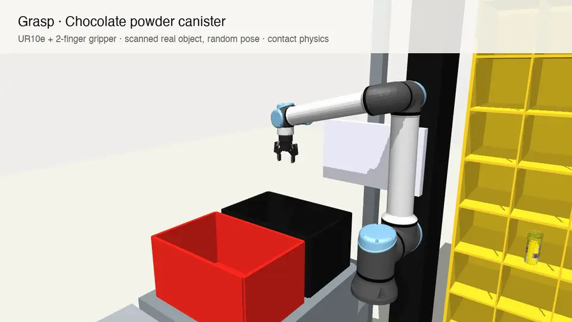
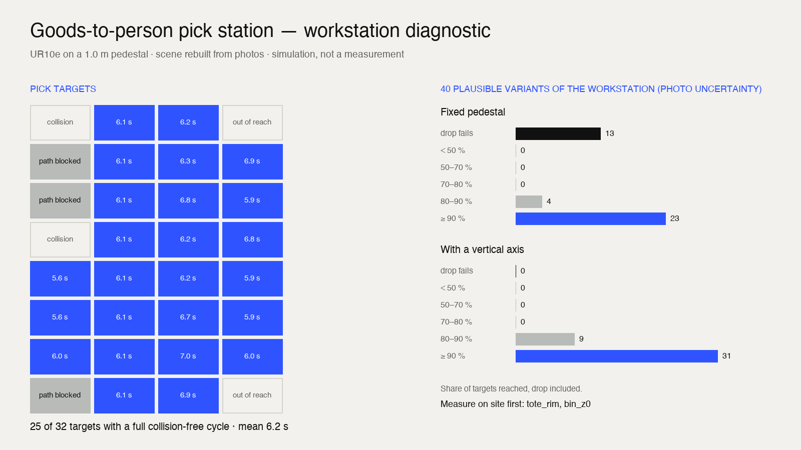

<div align="center">

# can-a-robot-do-it

**Show your coding agent a workstation. Get back a robot cell: which arm, where to put it, how fast, and what to measure first.**

[](LICENSE)
[](#install)
[](.claude/skills/workstation-sim/SKILL.md)
[](https://mujoco.org)
[](pyproject.toml)

[Install](#install) · [What you get](#what-you-get) · [How it works](#how-it-works) · [Results](#results-on-a-real-station) · [Limits](#what-it-does-not-do)



<sub>Three scanned real-world objects in random poses, picked with a 2-finger gripper in full contact physics, in a station rebuilt from phone photos.</sub>

</div>

<br>

Before anyone buys a robot, someone has to answer a simple question: *can a robot actually do this job, here?* Today that means a site visit, a tape measure and days in a CAD tool.

**can-a-robot-do-it** answers it from a few phone photos, inside the coding agent you already use. The agent reads the photos and rebuilds the workstation; a MuJoCo simulation tries real robot arms in it; you get a verdict with its uncertainty, and the short list of dimensions worth measuring on site.

```
  ● 3 phone photos + "pick from the shelf, drop in the tote"
  │
  ● your agent reads them      →  scene.json, every dimension ± its uncertainty
  │
  ● MuJoCo tries the arms      →  3 arms × 60 base positions, collision-free cycles, timed
  │
  ● 40 plausible variants      →  how sure the answer is, what moves it most
  │
  ✓ verdict · robot + base · cycle time · what to measure first
```

No API key. No CAD. Your agent does the reading, the simulation does the physics.

## Install

### Claude Code

```
/plugin marketplace add ari-robotics/can-a-robot-do-it
/plugin install can-a-robot-do-it@ari-robotics
```

### Codex, Cursor, Gemini CLI and other agents

Paste this into your agent, with your photos attached:

```
Clone https://github.com/ari-robotics/can-a-robot-do-it, set it up, and follow
.claude/skills/workstation-sim/SKILL.md to tell me whether a robot can do this
workstation. Task: [what is picked, from where, and where it goes].
```

The skill is a plain [`SKILL.md`](.claude/skills/workstation-sim/SKILL.md): any agent that can read files and run commands can follow it. The first run installs the Python package and downloads the robot models and scanned objects (~2.6 GB, once).

### Then ask

> *Can a robot do this station? [3 photos] An operator picks items from the shelf cells and drops them into the tote on the left.*

The agent asks only what the photos cannot tell it, checks its reconstruction against your photos, runs the simulation, and reports back.

## What you get



| | |
|---|---|
| **Verdict** | Reach validated for a pilot, valid if a few dimensions check out, marginal, or no feasible layout — and then which layout change would fix it |
| **Robot and base** | The arm that covers the station, where its base goes, how high the pedestal is |
| **Reach map** | Every pick target, reached or not, with a full collision-free cycle or not |
| **Cycle time** | Per target, at joint speed limits: a ceiling, said as such |
| **How sure** | How often the layout still works across dozens of plausible variants of the station |
| **Measure first** | The two or three dimensions that move the answer most: the only site visit you need |
| **Files** | `report.md`, `diagnostic.png`, `cycle.mp4`, and the `scene.json` to rerun anything |

## How it works

1. **Perceive.** The agent reads the photos and writes `scene.json`: the workstation as a handful of components (boxes, shelf units, totes, pick and place points). Every estimated dimension is a parameter *with its uncertainty*, tied to a scale reference visible in the photos. The scene is rendered and compared with the photos until they match.
2. **Diagnose.** Each candidate arm is tried at a grid of base positions and pedestal heights. For the best one, a collision-free path is planned to every pick target (IK, straight-line insertion, RRT-Connect) and timed at joint speed limits.
3. **Quantify the doubt.** A photo gives geometry to within 10–20 %. The scene is re-simulated on dozens of plausible variants, so the report says how often the layout holds and which dimensions matter most.
4. **Grasp (experimental).** A Robotiq 2F-85 replaces the suction tool, scanned real-world objects are dropped into the pick cells, and a scripted expert runs with contact physics. Episodes are recorded (image, joints, action) as raw material for imitation learning.

## Results on a real station

A goods-to-person pick station rebuilt from three phone photos: 32 shelf cells, one tote.

| | |
|---|---|
| **Robot** | UR10e, the only candidate that covers the station (UR5e and CRX-5iA rarely reach the tote) |
| **Base** | 0.6 m left of the shelf axis, 0.6 m back, on a 1.0 m pedestal |
| **Cycle** | 25 of 32 cells with a full collision-free cycle, about 6.2 s each at joint speed limits |
| **How sure** | Across 40 variants, a fixed pedestal loses the tote in 13; a vertical axis in none |
| **Measure first** | Tote rim height |

Physics grasping baseline, 300 episodes over 31 scanned objects with a parallel gripper: 17 delivered to the tote, 22 % of attempted grasps. That is the gap a learned policy has to close, and a hint that this station wants suction rather than fingers.

## What it does not do

- **It does not judge grasp reliability.** The diagnostic checks reach, clearance and timing. Whether a robot can grip a soft item behind an elastic band is a different question; the grasp module only starts on it.
- **Cycle times are ceilings.** Joint speed limits, no payload, no safety-rated speed reduction.
- **Geometry is primitives.** Boxes and cylinders are enough for reach and clearance, not for fine contact with the workstation itself.
- **Validated on one station so far.** The next step is ten stations with tape-measured dimensions, to report the real error per dimension.
- **Three arms today** (UR5e, UR10e, Fanuc CRX-5iA). Adding any arm from MuJoCo Menagerie is one line in [`ari_sim/robots.py`](ari_sim/robots.py).

## Roadmap

- [ ] Ten real stations with tape-measured dimensions: published error per dimension
- [ ] Suction end effector with physics, smarter grasp choice
- [ ] Episodes exported to LeRobot format, first learned policy
- [ ] Walk-around video in, for multi-view scale

<details>
<summary><b>Under the hood: the scene format and the commands the agent runs</b></summary>

<br>

A scene is JSON. Numbers can be expressions over named params, which is what makes the uncertainty run possible:

```json
"params":     { "tote_rim": {"value": 1.12, "sigma": 0.07, "note": "tote rim height"} },
"components": [ {"type": "tote", "name": "tote", "center": ["-(open_w/2 + 0.16 + tote_dx)", "tote_y"], "rim": "tote_rim", "place": true} ]
```

Components: `box`, `cylinder`, `shelf_unit` (every cell becomes a pick target), `tote` (drop target), `pick_point`, `place_point`. See [`ari_sim/spec.py`](ari_sim/spec.py) and the [example scene](examples/goods_to_person_station/scene.json). Expressions are parsed, never `eval`-ed.

What the agent runs, if you want to run it yourself:

```bash
pip install -e .
ari-sim setup                                   # robot models + scanned objects, in ~/.cache/ari_sim
ari-sim check    runs/my-station/scene.json     # validate and render the scene
ari-sim diagnose runs/my-station/scene.json --out runs/my-station/out
ari-sim grasp    runs/my-station/scene.json --episodes 100   # experimental
```

Headless Linux needs EGL (set by default). Video output needs `ffmpeg`.

</details>

## Built by ARI

[ARI — Applied Robotics Institute](https://arirobotics.ch) helps industrial teams decide what to automate and how. Want this run on your stations, or a robot cell designed from the answer? [Get in touch](https://arirobotics.ch).

Issues and pull requests are welcome, especially new arms, new component types, and stations with real measurements to test against.

## Acknowledgements and license

Code under the [Apache License 2.0](LICENSE). Nothing below is vendored; setup downloads it.

- [MuJoCo](https://mujoco.org) and the robot and gripper models of [MuJoCo Menagerie](https://github.com/google-deepmind/mujoco_menagerie) (per-model licences).
- [Google Scanned Objects](https://research.google/pubs/pub51437), MJCF conversion by [kevinzakka/mujoco_scanned_objects](https://github.com/kevinzakka/mujoco_scanned_objects), CC-BY 4.0.
