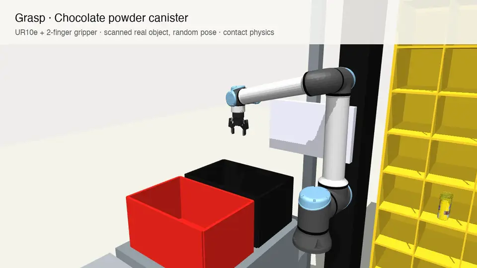
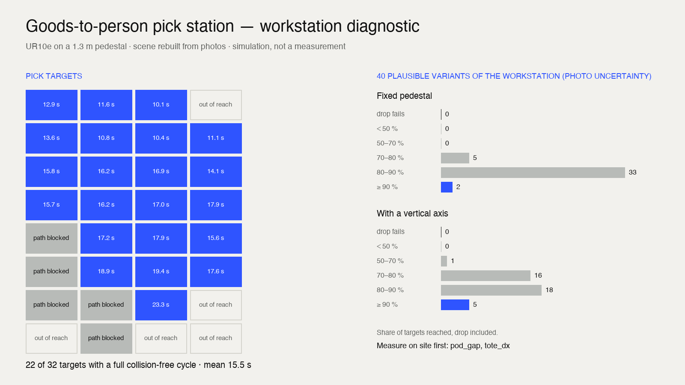

<div align="center">

# can-a-robot-do-it

**Show your coding agent a workstation to automate. It rebuilds it in simulation, then searches for the robot cell that does the job: which arm, which gripper, where, how fast, and what to measure first. Every computation runs on [Google DeepMind's robotics plugin](https://github.com/google-deepmind/robotics-antigravity-plugin).**

[](LICENSE)
[](#install)
[](.claude/skills/workstation-sim/SKILL.md)
[](https://mujoco.org)
[](#built-on-googles-robotics-tools)
[](pyproject.toml)

[Install](#install) · [What you get](#what-you-get) · [How it works](#how-it-works) · [Google's tools](#built-on-googles-robotics-tools) · [Results](#results-on-a-real-station) · [Limits](#what-it-does-not-do)



<sub>Three scanned real-world objects in random poses, picked with a 2-finger gripper in full contact physics, in a station rebuilt from phone photos. These are three successes: the scripted baseline delivers about one object in twenty today.</sub>

</div>

<br>

Before anyone buys a robot, someone has to answer a simple question: *can a robot actually do this job, here?* Today that means a site visit, a tape measure and days in a CAD tool.

**can-a-robot-do-it** answers it from a few phone photos or a video, inside the coding agent you already use, in two moves:

1. **Rebuild the use case.** The agent reconstructs the station in 3D with its collisions, using real objects from open simulation libraries where they exist, and works out what is picked, from where, to where.
2. **Search for the robotic configuration.** The parts decide the kind of tool (suction, fingers, other). The agent then iterates in simulation over arms, grippers and base positions, drawing on every library it can reach, until a configuration does the job or it can say exactly what blocks.

You get a verdict with its uncertainty, and the short list of dimensions worth measuring on site.

```
  ● 3 phone photos + "pick from the shelf, drop in the tote"
  │
  ● your agent rebuilds it     →  scene.json: real objects, every dimension ± its uncertainty
  │
  ● the parts decide the tool  →  suction, fingers or other; the model comes from the libraries
  │
  ● Google's planner tries     →  arms × tools × 60 base positions, collision-free cycles, timed
  │   the cells                   (not good enough? the agent changes the configuration and reruns)
  │
  ● 40 plausible variants      →  how sure the answer is, what moves it most
  │
  ✓ verdict · robot + base · cycle time · what to measure first
```

No API key. No CAD. Your agent does the reading; Google's robotics tools do the measuring, the planning and the physics.

## Install

One sentence to your agent is enough. There is no setup step: the first command the agent runs installs MuJoCo, the Python package and Google's robotics plugin in `~/.cache/ari_sim`, and fetches robot models as they are needed.

### Any agent (Claude Code, Codex, Cursor, Gemini CLI, Antigravity)

Paste this, with your photos attached:

```
Install https://github.com/ari-robotics/can-a-robot-do-it and tell me whether a robot
can do this workstation. Task: [what is picked, from where, and where it goes].
```

The agent clones the repo, reads [`AGENTS.md`](AGENTS.md) and the [skill](.claude/skills/workstation-sim/SKILL.md), and goes from there. You can also clone it yourself, open your agent in the folder and drop the photos in.

### Claude Code, as a plugin

```
/plugin marketplace add ari-robotics/can-a-robot-do-it
/plugin install can-a-robot-do-it@ari-robotics
```

The skill is then available in every project: share photos of a station anywhere and ask.

### What the machine needs

macOS or Linux, `git`, and either [`uv`](https://docs.astral.sh/uv/) or Python 3.11 to 3.13 (with `uv`, no Python is needed at all). `ffmpeg` adds the cycle video. About 500 MB of disk for MuJoCo, Google's plugin and the first robot models; the scanned objects of the physics run (400 MB) come only if that step is used. No API key, no account.

### Then ask

> *Can a robot do this station? [3 photos] An operator picks items from the shelf cells and drops them into the tote on the left.*

The agent asks only what the photos cannot tell it, checks its reconstruction against your photos, runs the simulation, and reports back.

## What you get



| | |
|---|---|
| **Verdict** | Reach validated for a pilot, valid if a few dimensions check out, marginal, or no feasible layout — and then which layout change would fix it |
| **Tool** | The kind of tool the parts call for, the model chosen, and its payload margin |
| **Robot and base** | The arm that covers the station, where its base goes, how high the pedestal is |
| **Reach map** | Every pick target, reached or not, with a full collision-free cycle or not |
| **Cycle time** | Per target, at joint speed limits: a ceiling, said as such |
| **How sure** | How often the layout still works across dozens of plausible variants of the station |
| **Measure first** | The two or three dimensions that move the answer most: the only site visit you need |
| **Live view** | The station and the winning cell in MuJoCo Studio: watch each cycle, show the collision shapes, edit and reload |
| **Files** | `report.md`, `diagnostic.png`, `cycle.mp4`, the station as a MuJoCo asset, its audit and turntable, and the `scene.json` to rerun anything |

## How it works

1. **Perceive.** The agent reads the photos and writes `scene.json`: the workstation as a handful of components (boxes, shelf units, totes, pick and place points). Every estimated dimension is a parameter *with its uncertainty*. Where a scale reference lies on the plane that matters (a Euro tote, a pallet, an A4 sheet), `ari-sim measure` turns pixels into metres with Google's localization tool and returns the uncertainty with them.
2. **Rebuild and check.** The station is written as a MuJoCo asset to Google's asset standards (visual and collision geometry kept apart, containers left hollow), audited, rendered as a turntable with its collision shapes, and compared with the photos until they match.
3. **Choose the tool from the use case.** Suction for cartons and anything with a flat airtight face, fingers for parts, tools and bottles, the trade's tool for the rest. The parts decide the kind of tool, not the simulation score; the agent asks you only what the photos cannot show (material, weight). The model then comes from the libraries: presets, or any maker's gripper in SimReady, mounted with its real geometry.
4. **Search the cell, and iterate.** Each candidate arm is tried at a grid of base positions and pedestal heights with Google's motion planner; if nothing passes, the agent changes arm, tool model or base and reruns. For the best one, a collision-free cycle is planned to every pick target (multi-start IK, bidirectional RRT, straight-line insertion) and timed under joint speed, acceleration and tool speed limits.
5. **Quantify the doubt.** A photo gives geometry to within 10–20 %. The scene is re-simulated on dozens of plausible variants, so the report says how often the layout holds and which dimensions matter most.
6. **Execute with physics (experimental).** A Robotiq 2F-85 on the chosen arm, scanned real-world objects dropped into the pick cells, the part located from the station camera, and a staged scripted pick whose success is measured after release, once the part is at rest. Episodes are recorded (image, joints, action) as raw material for imitation learning.

## Built on Google's robotics tools

Nothing below is reimplemented here. `ari-sim` calls the skills of [google-deepmind/robotics-antigravity-plugin](https://github.com/google-deepmind/robotics-antigravity-plugin) in the order the question needs, and the agent loads the same skills when a step needs judgment. `ari-sim doctor` shows what is installed.

| Step | Google skill | Used for | Wired in |
|---|---|---|---|
| Read the photos | `rgb-object-localization` | metres from pixels through a scale reference; object pointing with Gemini if you set a key yourself | `ari-sim measure`, `ari-sim detect` |
| Rebuild the station | `mujoco-spec-editing`, asset standards | station as a reusable MuJoCo asset | `ari-sim check` |
| Check the rebuild | `mujoco-audit` | static and physics audit | `ari-sim audit` |
| | `mujoco-showcase-shot` | turntable with collision overlay | `ari-sim showcase` |
| | `mujoco-studio-sidecar`, `mujoco-studio` | live, hot-reloading 3D view | `ari-sim studio` |
| Search the cell | `motion-planning` | all IK, collision checks, paths and timings | `ari-sim diagnose` |
| Execute | `iteration`, `rgb-object-localization`, `motion-planning` | staged pick, part located by camera, measured after settle | `ari-sim execute` |
| Missing object | `blender-creation` | model it from the photos (needs Blender) | the agent, through the skill |
| Compare cells, go to a real arm | `visual-servoing`, `sim2real-gauntlet`, `sim2real-iteration`, `mujoco-playground`, `mujoco-playground-rl`, SO-101, YAM and FR3 bring-up, `share-example` | wrist-camera alignment, perturbation tiers, the same controller on a real arm, sharing the run | the agent, through the skill |

The last two rows are not called from `ari-sim` yet: they need Blender, the `mujoco_playground` stack or a physical arm. The skill file tells the agent when to load them.

## Real objects and real robots, fetched one at a time

The agent does not rebuild everything from boxes. [SimReady Central](https://huggingface.co/spaces/nvidia/simready-central) indexes thousands of simulation-ready objects and the robot arms and grippers their manufacturers publish (FANUC, Universal Robots, Franka, Comau, Robotiq, OnRobot...). When the photos show one of them, the agent finds it, checks it by eye, and downloads only that.

```
  ● ari-sim assets search plastic crate 600x400   →  asset ids + download size, nothing fetched yet
  ● ari-sim assets show <id>                      →  a 4 kB thumbnail the agent compares with your photos
  ● ari-sim assets get <id>                       →  3.6 MB of geometry and physics, real mass and friction
  ● ari-sim robots inspect <id>                   →  a manufacturer's arm: joints, limits, flange
```

Only geometry and physics layers are fetched, never textures: a screwdriver is 2 MB instead of 91 MB. Files are read by [MuJoCo 4](https://github.com/google-deepmind/mujoco/releases)'s own OpenUSD importer and handed to Google's planner as they are. A FANUC CRX-5iA read this way matches the MuJoCo Menagerie model to within a micrometre at the tool flange. Joint speeds, reach and payload are not in the files: they come from datasheets, cited in the scene.

## Results on a real station

A goods-to-person pick station rebuilt from three phone photos: 32 shelf cells, one tote.

| | |
|---|---|
| **Robot** | UR10e: 27 of 32 cells within reach, drop included (CRX-5iA 13, UR5e 6) |
| **Base** | 0.6 m left of the shelf axis, 0.8 m back, on a 1.3 m pedestal |
| **Cycle** | 22 of 32 cells with a full collision-free cycle, 15.5 s on average (10 to 23 s) under joint speed, acceleration and 1 m/s tool limits |
| **How sure** | Across 40 variants the drop stays reachable in all of them, and at least 80 % of the cells in 35 |
| **Measure first** | Gap between the portal and the pod face, then the tote's distance from the portal |

The whole run, 180 base positions for three arms, 27 planned cycles and 40 variants, takes about two and a half minutes on a laptop. Cycle times are roughly twice those of the first version of this repo, which timed straight joint moves with no acceleration limit: Google's planner gives a slower and more honest ceiling.

Physics execution baseline, 90 episodes over scanned objects with a parallel gripper: 44 objects too wide for the gripper, 26 with no reachable or collision-free grasp, 20 grasps attempted, 4 delivered to the tote and at rest. The part is located from the station camera to 13 mm (median). That is the gap a learned policy has to close, and a hint that this station wants suction rather than fingers.

## What it does not do

- **It does not judge grasp reliability.** The diagnostic checks reach, clearance and timing. Whether a robot can grip a soft item behind an elastic band is a different question; the grasp module only starts on it.
- **Cycle times are ceilings.** Joint speed and acceleration limits and 1 m/s at the tool, no payload, no safety-rated speed reduction, paths not optimised for time.
- **Geometry is primitives.** Boxes and cylinders are enough for reach and clearance, not for fine contact with the workstation itself.
- **Validated on one station so far.** The next step is ten stations with tape-measured dimensions, to report the real error per dimension.
- **Suction is checked for reach and clearance, not for seal.** Contact physics exists only for the 2-finger gripper, and library grippers are simulated in the pose their model file defines.
- **Collisions with the station use its primitives.** A library mesh used as a fixture is avoided as its bounding box.
- **Not every Google tool is called automatically.** The gauntlet, the real-arm skills and Blender modelling are run by the agent when needed, not by `ari-sim` (see the table above).
- **Serial arms on a fixed base.** Six presets (UR5e, UR10e, FANUC CRX-5iA and CRX-10iA, UFactory Lite 6, the seven-axis Franka FR3), and any SimReady arm whose datasheet gives its joint speeds. The base is searched in position, not in rotation; no mobile base, no second arm.
- **Catalog assets are as good as their data.** Masses that look implausible for the size are flagged for a person to check.

## Roadmap

- [ ] Ten real stations with tape-measured dimensions: published error per dimension
- [ ] Suction end effector with physics, smarter grasp choice
- [ ] Station as a `sim2real-gauntlet` task: perturbation tiers and paired comparison of two cells
- [ ] Base rotation in the search; fixture meshes as convex parts in the planner
- [ ] Episodes exported to LeRobot format, first learned policy
- [ ] Walk-around video in, for multi-view scale

<details>
<summary><b>Under the hood: the scene format and the commands the agent runs</b></summary>

<br>

A scene is JSON. Numbers can be expressions over named params, which is what makes the uncertainty run possible:

```json
"params":     { "tote_rim": {"value": 1.12, "sigma": 0.07, "note": "tote rim height"} },
"components": [ {"type": "tote", "name": "tote", "center": ["-(open_w/2 + 0.16 + tote_dx)", "tote_y"], "rim": "tote_rim", "place": true} ]
```

Components: `box`, `cylinder`, `shelf_unit` (every cell becomes a pick target), `tote` (drop target), `pick_point`, `place_point`, and `asset` (a SimReady object as a fixture, a container or an item to pick). See [`ari_sim/spec.py`](ari_sim/spec.py) and the [example scene](examples/goods_to_person_station/scene.json). Expressions are parsed, never `eval`-ed.

What the agent runs, if you want to run it yourself:

```bash
alias ari-sim=.claude/skills/workstation-sim/scripts/ari-sim   # installs itself on first use, in ~/.cache/ari_sim
ari-sim assets search plastic crate             # SimReady: search, show, get
ari-sim robots list                             # preset arms; `robots inspect <id>` for a SimReady one
ari-sim doctor                                  # Google's tools: which are installed, what each is used for
ari-sim measure --ref U V X Y (x4) --point U V  # metres from pixels, with a scale reference
ari-sim check    runs/my-station/scene.json     # validate, render, export the station as a MuJoCo asset
ari-sim audit    runs/my-station/scene.json     # Google's mujoco-audit on that asset
ari-sim showcase runs/my-station/scene.json     # Google's turntable with collision overlay
ari-sim diagnose runs/my-station/scene.json --out runs/my-station/out
ari-sim studio   runs/my-station/scene.json --out runs/my-station/out   # live view in MuJoCo Studio
ari-sim execute  runs/my-station/scene.json --episodes 100   # experimental
```

Headless Linux needs EGL (set by default). Video output needs `ffmpeg`; Google's standalone scripts (audit, showcase) run through [`uv`](https://docs.astral.sh/uv/).

</details>

## Built by ARI

[ARI — Applied Robotics Institute](https://arirobotics.ch) helps industrial teams decide what to automate and how. Want this run on your stations, or a robot cell designed from the answer? [Get in touch](https://arirobotics.ch).

Issues and pull requests are welcome, especially new arms, new component types, and stations with real measurements to test against.

## Acknowledgements and license

Code under the [Apache License 2.0](LICENSE). Nothing below is vendored; setup downloads it.

- [Google DeepMind's robotics plugin](https://github.com/google-deepmind/robotics-antigravity-plugin) (Apache-2.0): motion planning, localization, asset audit, showcase rendering, MuJoCo Studio daemon, and the working rules this repo follows.
- [MuJoCo](https://mujoco.org) and the robot and gripper models of [MuJoCo Menagerie](https://github.com/google-deepmind/mujoco_menagerie) (per-model licences).
- [NVIDIA SimReady](https://huggingface.co/spaces/nvidia/simready-central) assets and manufacturers' robot models, fetched one at a time under each dataset's licence (CC-BY 4.0 for nvidia/simready-assets, Apache-2.0 for the FANUC arms).
- [Google Scanned Objects](https://research.google/pubs/pub51437), MJCF conversion by [kevinzakka/mujoco_scanned_objects](https://github.com/kevinzakka/mujoco_scanned_objects), CC-BY 4.0.
